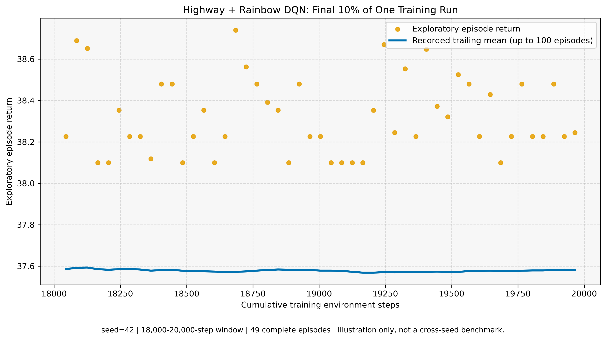
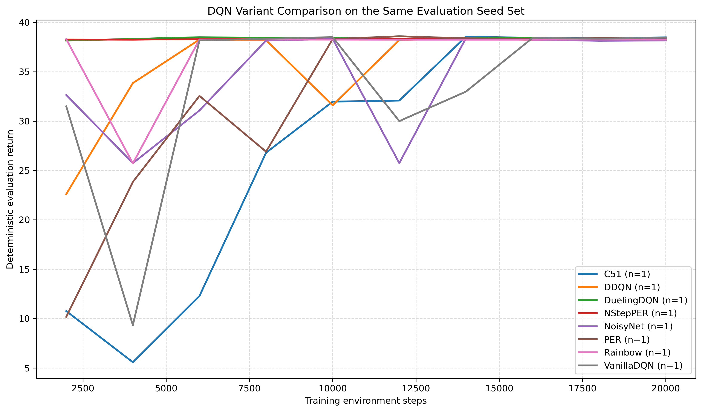

# Rainbow DQN Experiments

這是一個以 `highway-v0` 為任務的 Deep Reinforcement Learning 作品集專案。我在離散動作控制環境中實作 DQN 的多個改良版本與完整 Rainbow DQN，並建立固定訓練步數、seed 與 deterministic evaluation 的受控實驗流程，用來觀察實作是否能穩定執行、訓練資料如何產生，以及不同 value-based 設計的行為差異。

> 本專案是 Rainbow DQN 的實作與受控實驗工具，不是 Rainbow 論文 benchmark 的官方重現、模型效能排名，也不是 PPO 對照實驗。

## 快速總覽

| 項目 | 內容 |
|---|---|
| 主要任務 | `highway-v0` 離散動作駕駛決策環境 |
| 主要演算法 | Rainbow DQN |
| 實作版本 | Vanilla DQN、Double DQN、Dueling DQN、PER、N-step PER、NoisyNet、C51、Rainbow |
| 實驗控制 | 固定 training-step budget、訓練 seed 與 deterministic evaluation seed set |
| 已保存 pilot | training seed `42`、每個 Agent `20,000` environment steps、`n=1` |
| 可驗證內容 | 單元測試、Agent smoke test、N-step 邊界處理、checkpoint metadata 與 evaluation 流程 |

## 為什麼選擇 Highway？

早期實驗使用 LunarLander；但它能在較早階段取得高分，使後續網路架構或演算法元件的差異不容易觀察。因此主實驗改為 Highway：它仍是訓練成本合理的離散動作任務，但狀態與決策情境更複雜，較適合用來觀察 DQN 變體的訓練過程。

目前 Highway 設定使用：

- `DiscreteMetaAction` 離散動作空間。
- 五輛車的 kinematic observation，特徵為 `presence`、`x`、`y`、`vx`、`vy`。
- 展平後 observation shape 為 `[25]`。
- 每個 episode 最多 40 steps，碰撞 reward 為 `-10`，speed reward 範圍為 `[20, 30]`。

這是一組用於學習與比較流程的設定，不是標準化 benchmark 設定。

## Pilot：執行驗證，不是效能排名

### Rainbow 單次訓練末段示意



這張圖保留一段可檢查的實際訓練紀錄：

- 演算法：`Rainbow`；環境：`highway-v0`；training seed：`42`。
- 固定訓練預算為 `20,000` environment steps。
- 資料取自最後 10% 的完整 exploratory training episodes：episodes 536–584，共 49 筆，步數範圍為 `18,005`–`19,965`。
- 可直接查看對應的 [CSV 資料](assets/data/highway-pilot-rainbow-seed-42-final-10pct-training.csv)。

圖中的散點 `score` 是單一 exploratory episode 的 return；實線 `avg_score` 是最多 100 個完整 episodes 的 trailing mean，因此它也包含這個末段區間之前的訓練歷史。最後一個因為剛好到達固定 step budget 而被截斷的 partial episode 已排除，避免被誤讀成自然 episode 的表現。

在這個特定 seed 的 pilot 中，Rainbow 在訓練最後 10% 呈現穩定的晚期 training signal。這只能說明這一次訓練資料的樣貌與流程可檢查；**不能**據此宣稱 Rainbow 已被科學性地證明收斂、優於其他 Agent，或重現原論文結果。

### 八個 Agent 的固定評估流程



八個 Agent 都以相同的 `20,000`-step budget、training seed `42` 執行。每訓練 `2,000` steps，就以相同的五個 deterministic evaluation episodes 評估一次；每個 Agent 皆完成固定預算與 `4,984` 次 gradient updates。

此圖的用途是驗證共同的 training/evaluation pipeline 能對所有已宣告的 Agent 產生可讀的 learning trace ，是單一 training seed 的 pilot（`n=1`）。

## 已實作的 Agent

| Agent | Double DQN | Dueling | PER | N-step | C51 | NoisyNet |
|---|:---:|:---:|:---:|:---:|:---:|:---:|
| `VanillaDQN` | - | - | - | - | - | - |
| `DDQN` | ✓ | - | - | - | - | - |
| `DuelingDQN` | ✓ | ✓ | - | - | - | - |
| `PER` | - | - | ✓ | - | - | - |
| `NStepPER` | - | - | ✓ | ✓ | - | - |
| `NoisyNet` | ✓ | - | - | - | - | ✓ |
| `C51` | ✓ | - | - | - | ✓ | - |
| `Rainbow` | ✓ | ✓ | ✓ | ✓ | ✓ | ✓ |

Rainbow 將 Double DQN、Dueling Networks、Prioritized Experience Replay、multi-step return、C51 distributional RL 與 Noisy Networks 整合在同一個 Agent 中。

### 八個 Agent 的設計差異

這八個版本不是單純依序加功能；它們是用來分別觀察不同設計選擇的實作變體。除了 `Rainbow` 以外，多數版本只保留少量元件，讓資料流與訓練差異較容易閱讀。

| Agent | 相對於 Vanilla DQN 的核心改動 | 主要想處理的問題 | 實作位置 |
|---|---|---|---|
| `VanillaDQN` | 標準 Q-network、standard replay buffer、epsilon-greedy、MSE loss 與 soft target update。 | 作為最基本的 value-based baseline。 | `agents/base_agent.py` 的 `BaseAgent`、`QNetwork` |
| `DDQN` | 使用 online network 選擇下一步 action，再由 target network 評估該 action。 | 降低 Vanilla DQN 以同一估計值選擇與評估 action 時可能產生的 Q-value overestimation。 | `agents/ddqn_agent.py` 的 `DDQNAgent.learn()` |
| `DuelingDQN` | 延續 Double DQN 的 target 計算，但將網路拆成 shared feature、state value `V(s)` 與 action advantage `A(s,a)` 兩個 stream。 | 在「多個 action 差異不大」的狀態下，分開學習狀態本身的價值與動作相對優勢。 | `agents/dueling_agent.py` 的 `DuelingQNetwork` |
| `PER` | 以 `PrioritizedReplayBuffer` 取代 uniform replay；依 TD error 更新 priority，並以 importance-sampling weights 修正加權 MSE loss。 | 讓 TD error 較大的 transition 更常被學到，而不是完全均勻抽樣。 | `agents/per_agent.py`、`buffer.py` 的 `PrioritizedReplayBuffer`、`SumTree` |
| `NStepPER` | 在 PER 前先用 `NStepDeque` 累積 reward；本專案預設為 3-step return，target 使用每筆 transition 實際跨越步數的 `gamma^n`。 | 讓 reward 訊號更快往前傳遞，同時保留優先經驗回放。 | `agents/nstep_per_agent.py`、`buffer.py` 的 `NStepDeque` |
| `NoisyNet` | 以 Double DQN 為基礎，將後段線性層換成 `NoisyLinear`；訓練時由可學習的 parameter noise 探索，不使用 epsilon-greedy。 | 讓 exploration 強度成為網路可學習的一部分，而非依固定 epsilon 規則隨機選 action。 | `agents/noisy_agent.py` 的 `NoisyLinear`、`NoisyAgent` |
| `C51` | 以 Double DQN 的 action-selection 邏輯為基礎，但網路輸出每個 action 的 51 個 return-distribution atoms；訓練使用 C51 projection 與 cross-entropy loss。 | 不只估計單一期望 Q value，也學習 return 的離散機率分佈。 | `agents/c51_agent.py` 的 `C51QNetwork`、`C51Agent.learn()` |
| `Rainbow` | 整合 Double DQN、Dueling、PER、N-step、C51 與 NoisyNet；使用 dueling noisy distributional network、PER 加權 C51 loss、N-step discount 與 gradient clipping。 | 將多個已知的 DQN 改良整合為同一條訓練資料流，觀察完整組合在離散 Highway 任務中的執行與訓練行為。 | `agents/rainbow_agent.py` 的 `RainbowQNetwork`、`RainbowAgent` |

> `PER` 與 `NStepPER` 在這份專案中不是 Double DQN 版本；`NoisyNet` 與 `C51` 則各自以 Double DQN 為基礎。這些版本是方便理解與檢查元件的實作組合，並非原論文嚴格的「一次只移除一個 Rainbow 元件」ablation 設計。

所有 Agent 都共享基本訓練骨架：從 replay buffer 取出 batch、更新 online network，並以 soft update 維護 target network。差異主要落在 target 計算、network architecture、replay sampling、return horizon、value representation 與 exploration strategy。

## 架構與資料流

```text
Gymnasium environment
        |
        v
state observation
        |
        v
agent.act(state)
        |
        v
selected discrete action
        |
        v
environment.step(action)
        |
        v
(state, action, reward, next_state, done)
        |
        +-- DQN / DDQN / Dueling / NoisyNet / C51：standard replay buffer
        +-- NStepPER / Rainbow：n-step aggregation + prioritized replay
        |
        v
sample training batch -> online prediction -> target calculation
        |
        v
loss -> backpropagation -> optimizer update -> soft target update
```

Rainbow 的網路不只輸出單一 Q value，而是輸出每個 action 的 return distribution：

```text
state [batch, state_dim]
        |
        v
RainbowQNetwork
        |
        v
action distribution [batch, action_dim, 51 atoms]
        |
        v
expected Q-value = sum(probability * support)
        |
        v
argmax action
```

## Rainbow 元件在程式碼中的位置

| 元件 | 主要實作位置 |
|---|---|
| Double DQN | `agents/ddqn_agent.py`、`agents/c51_agent.py`、`agents/rainbow_agent.py` |
| Dueling Network | `agents/dueling_agent.py`、`agents/rainbow_agent.py` 的 `RainbowQNetwork` |
| Prioritized Experience Replay | `buffer.py` 的 `PrioritizedReplayBuffer` 與 `SumTree` |
| N-step Return | `buffer.py` 的 `NStepDeque` |
| C51 / Distributional RL | `agents/c51_agent.py`、`agents/rainbow_agent.py` |
| Noisy Networks | `agents/noisy_agent.py` 的 `NoisyLinear` |

## 快速開始

此公開路徑已在 Python `3.9.21`、PyTorch `2.3.1`、Gymnasium `1.1.1` 與 `highway-env` `1.10.1` 下驗證。可使用現有相容的 Python 環境，或建立虛擬環境後安裝依賴：

```bash
python -m venv .venv
python -m pip install --upgrade pip
python -m pip install -r requirements.txt
```

如需使用 GPU 版 PyTorch，請先依照本機 CUDA 與官方 PyTorch 安裝選擇器安裝相容版本，再安裝其餘依賴。

### 執行測試

```bash
python -m unittest discover -s tests
```

### 執行 Highway + Rainbow

Highway 入口預設使用 Rainbow；可用 `--algo` 選擇其他已實作版本。

```bash
# 快速 smoke run
python train_highway.py --algo Rainbow --episodes 5

# 固定訓練步數，並定期進行 deterministic evaluation
python train_highway.py --algo Rainbow --seed 42 --total-env-steps 10000 --eval-every-steps 1000 --eval-episodes 10
```

使用 `--total-env-steps` 時，訓練會精確停止在指定的 training environment interactions；early stopping 預設停用，epsilon-greedy exploration 與 PER beta 皆依 step schedule 調整，N-step Agent 會安全地 flush 最後的 partial episode。

訓練產物會寫入：

```text
runs/Highway/<algorithm>_<timestamp>/
├── config.json
├── training_log.csv
├── evaluation_episodes.csv
├── evaluation_summary.csv
├── run_summary.json
├── best_model.pt
└── final_model.pt
```

`runs/`、checkpoint 與完整原始 log 都不包含在公開版本中。NoisyNet 與 Rainbow 的 exploration 來自 parameter noise，因此 training log 的 `epsilon_greedy` 欄位會刻意留白。

### 評估 checkpoint

新的 metadata checkpoint 可還原演算法、環境、網路設定、seed 與記錄的套件版本：

```bash
python evaluate.py --model runs/Highway/Rainbow_<timestamp>/final_model.pt --episodes 5 --no-render
```

移除 `--no-render` 可開啟 renderer。Evaluation 使用 deterministic greedy policy；對 NoisyNet 與 Rainbow 而言，`NoisyLinear.eval()` 會使用學得的 mean parameters，不重新抽取 parameter noise。

## 受控實驗

`run_experiments.py` 會依序執行每個指定的 algorithm × seed job，確保每個 job 有相同的 training environment-step budget、相同的 early-stopping policy 與相同的 deterministic evaluation seed set。

先用低成本 smoke test 檢查整個資料路徑：

```bash
python run_experiments.py --name smoke-all-agents --env Highway --algorithms VanillaDQN DDQN DuelingDQN PER NStepPER NoisyNet C51 Rainbow --seeds 42 --total-env-steps 256 --eval-every-steps 128 --eval-episodes 2
```

若要做可比較的實驗，應至少使用三個 training seeds（五個較佳），並在 pilot 後再決定合理的訓練預算：

```bash
python run_experiments.py --name highway-dqn-variants-v1 --env Highway --algorithms VanillaDQN DDQN DuelingDQN PER NStepPER NoisyNet C51 Rainbow --seeds 0 1 2 --total-env-steps <CHOSEN_BUDGET> --eval-every-steps <CHOSEN_INTERVAL> --eval-episodes 10
```

完成後可產生 deterministic evaluation 與 exploratory training diagnostics：

```bash
python plot_results.py --experiment-dir runs/experiments/highway-dqn-variants-v1
```

## 已驗證內容

在既有 Conda 環境中已完成以下檢查：

- 12 個 configuration、schedule、aggregation、N-step、all-agent smoke 與 plotting tests 通過。
- 10-episode Highway + Rainbow smoke test 完成 133 environment steps，包含 replay sampling 與 gradient updates。
- 產生的 metadata checkpoint 已成功載入，並與目前 Highway 環境設定核對。
- 兩次 deterministic、無 renderer 的 evaluation 回傳相同的兩個 episode scores。
- 八個 Agent 的 Highway smoke matrix 都完成精確的 128-step budget、寫入 scheduled evaluations，且每個 job 至少執行一次 gradient update。

## 預設 Highway 超參數

| 參數 | 預設值 |
|---|---:|
| Replay buffer size | 100,000 |
| Batch size | 64 |
| Discount factor `gamma` | 0.99 |
| Learning rate | 5e-4 |
| Soft target update `tau` | 1e-3 |
| Update interval | 4 environment steps |
| N-step return | 3 |
| C51 atoms | 51 |
| C51 support | `[-50, 50]` |
| Hidden-layer width | 256, 256 |
| PER alpha | 0.6 |
| PER beta | 從 0.4 anneal 至 1.0 |

## 專案結構

```text
.
├── agents/                    # 各 DQN 變體與 Rainbow Agent
├── assets/
│   ├── data/                  # 經挑選、可公開的末段訓練 CSV
│   └── figures/               # README 使用的 pilot 圖與技術附圖
├── tests/                     # 單元測試、N-step、Agent smoke 與結果測試
├── agent_factory.py           # algorithm 名稱與 Agent class 的對應
├── buffer.py                  # ReplayBuffer、SumTree、PER、N-step deque
├── checkpointing.py           # checkpoint metadata 與驗證 helper
├── config.py                  # 超參數與 run configuration
├── environment.py             # Gymnasium environment factory
├── evaluate.py                # checkpoint evaluation CLI
├── experiment_results.py      # evaluation 結果驗證與彙整
├── plot_results.py            # 實驗圖表工具
├── run_experiments.py         # algorithm × seed 實驗執行器
├── train.py                   # 共用 training loop
├── train_highway.py           # Highway 主要入口
└── utils.py                   # seed 設定與輔助功能
```

## 限制與後續方向

- 公開的 20,000-step 圖表只使用一個 training seed（`n=1`），不能提供統計顯著性、一般化比較或 component ablation 結論。
- 八個 Agent 是實作變體，並非原論文嚴格的 `Rainbow - one component` ablation 設計。
- 現有歷史 logs 與 checkpoints 因缺少足夠 metadata 而不公開；新產生的 checkpoint 則包含環境、演算法、設定、seed、套件版本與訓練進度。
- 固定 evaluation seed set 可以降低 evaluation-environment noise，但無法保證跨硬體、作業系統、GPU 或套件版本的 bit-for-bit 可重現性。
- 本專案聚焦離散動作下的 value-based 方法。它幫助我理解 DQN/Rainbow 在有限離散 action space 的取捨；若未來要直接與 PPO 比較，必須建立匹配的環境、訓練預算、多個 seeds 與相同 evaluation protocol，而不應從這份 `n=1` pilot 推論 PPO 優劣。

## 參考資料

Hessel, M., Modayil, J., van Hasselt, H., Schaul, T., Ostrovski, G., Dabney, W., Horgan, D., Piot, B., Azar, M., & Silver, D. (2018). *Rainbow: Combining Improvements in Deep Reinforcement Learning.* Proceedings of the AAAI Conference on Artificial Intelligence. https://arxiv.org/abs/1710.02298

## 使用範圍

本 repository 僅供作品集檢閱與程式碼閱讀；未授予開源授權、再散布或衍生使用的權利。
